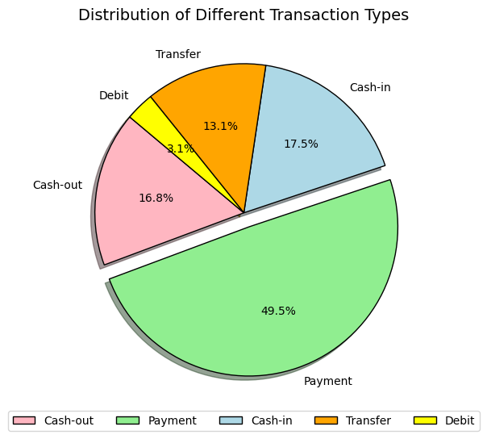
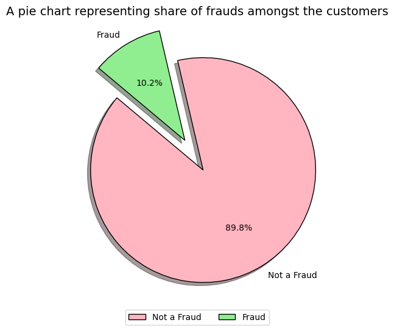
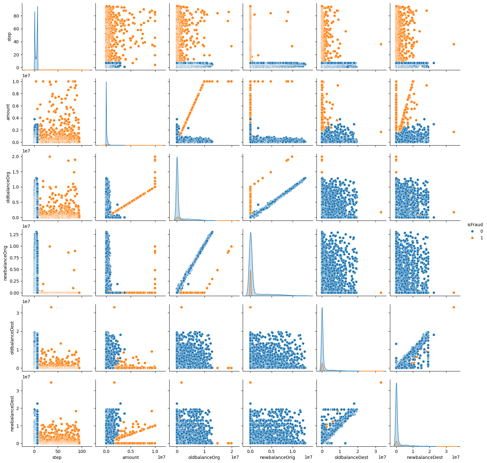
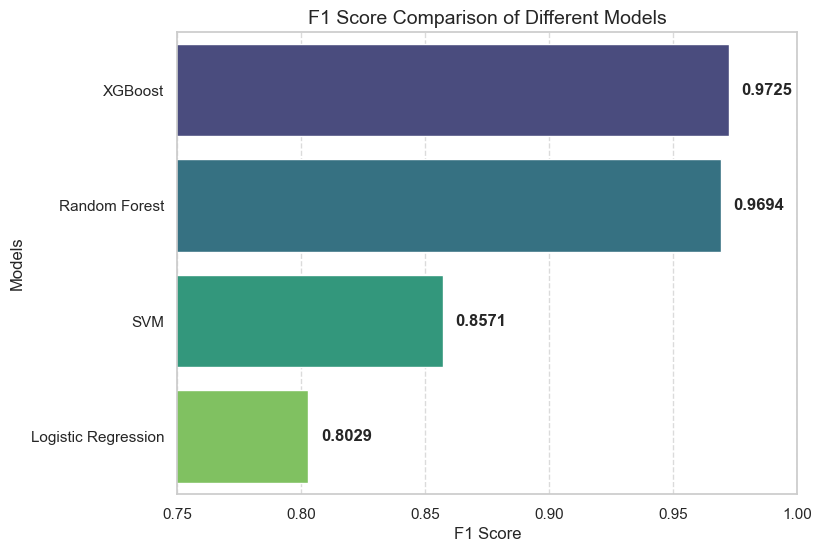
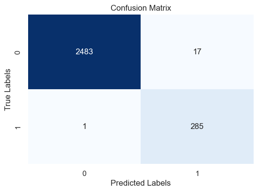
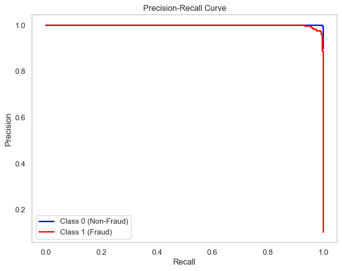
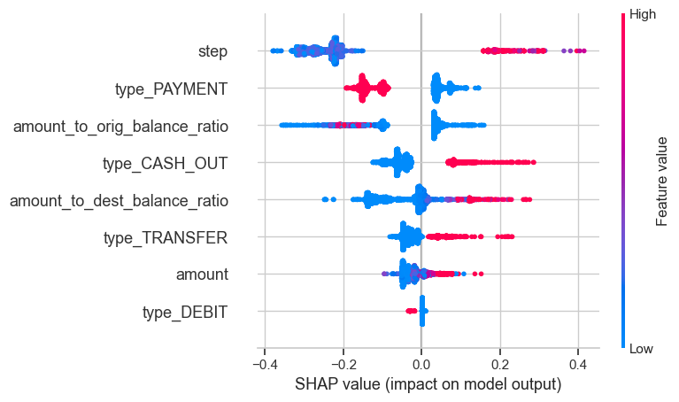

#  Fraud Detection in Mobile Financial Transactions

**An end-to-end machine learning project that flags fraudulent mobile-money transactions, explains *why* they were flagged, and estimates the business value of catching them.**


---

## 📌 Table of Contents

1. [Project Overview](#-project-overview)
2. [Headline Results](#-headline-results)
3. [Dataset](#-dataset)
4. [Workflow](#-workflow)
5. [Key EDA Findings](#-key-eda-findings)
6. [Feature Engineering & Preprocessing](#-feature-engineering--preprocessing)
7. [Modelling & Results](#-modelling--results)
8. [Explainability with SHAP](#-explainability-with-shap)
9. [Business Impact](#-business-impact)
10. [Limitations](#-limitations)
11. [Future Work](#-future-work)
12. [Repository Structure](#-repository-structure)
13. [How to Run](#-how-to-run)
14. [Author](#-author)

---

##  Project Overview

Fraud in digital payments causes large financial losses and erodes customer trust. The challenge for a data team is that fraud is **rare**, so a model can look "accurate" while missing most of it.

This project builds a classifier that catches fraudulent transactions with **high recall** (few missed frauds) while keeping false alarms low enough to be manageable for a review team.

**Objectives**

- **Explore** the data and uncover patterns linked to fraud
- **Engineer** features and preprocess the data for modelling
- **Handle class imbalance** and compare several classifiers
- **Evaluate** with precision, recall, F1 and AUC-ROC rather than accuracy alone
- **Explain** the final model with SHAP and translate results into business impact

---

##  Headline Results

| Metric (final Random Forest, held-out test set) | Value |
|---|---|
| Fraud **recall** | **~100%** (285 of 286 frauds caught) |
| Fraud **precision** | **0.94** (17 false alarms out of 2,500 legitimate transactions) |
| Fraud F1-score | **0.97** |
| AUC-ROC | **0.995** |
| Overall accuracy | 99.35% |

> Four models were tuned with 5-fold stratified cross-validation. The two ensemble models (Random Forest, XGBoost) clearly outperformed Logistic Regression and SVM. See [Modelling & Results](#-modelling--results).

---

## 📂 Dataset

| Property | Detail |
|---|---|
| File | `Fraud_Analysis_Dataset.csv` |
| Size | 11,142 transactions × 10 columns |
| Target | `isFraud` (1 = fraud, 0 = legitimate) |
| Class split | 10,000 legitimate vs **1,142 fraud (~10.2%)** |
| Missing values / duplicates | None |

| Column | Description |
|---|---|
| `step` | Unit of time (1 step = 1 hour) |
| `type` | `CASH_IN`, `CASH_OUT`, `DEBIT`, `PAYMENT`, `TRANSFER` |
| `amount` | Transaction amount in local currency |
| `nameOrig` / `nameDest` | Sender / recipient identifiers |
| `oldbalanceOrg` / `newbalanceOrig` | Sender balance before / after |
| `oldbalanceDest` / `newbalanceDest` | Recipient balance before / after (not available for merchants, whose IDs start with `M`) |
| `isFraud` | Fraud label |

---

## 🔄 Workflow

```
Raw data → Data wrangling → EDA (uni / bi / multivariate) → Feature engineering
   → Encoding & hypothesis tests → Train/test split → Scaling + log transform
   → Random undersampling → Model training → Hyperparameter tuning (GridSearchCV)
   → Model selection → SHAP explainability → Business impact analysis
```

---

## 🔍 Key EDA Findings

**1. Fraud only happens in two transaction types.**
`TRANSFER` has a **38.5%** fraud rate and `CASH_OUT` **30.9%**. `PAYMENT`, `CASH_IN` and `DEBIT` had **zero** fraud in this dataset. This matches the classic pattern of moving money to a mule account and then cashing it out.

| Type | Transactions | Fraud rate |
|---|---:|---:|
| PAYMENT | 5,510 | 0.00% |
| CASH_IN | 1,951 | 0.00% |
| CASH_OUT | 1,871 | 30.89% |
| TRANSFER | 1,464 | 38.52% |
| DEBIT | 346 | 0.00% |

<p align="center">
  
  
</p>

**2. Fraudulent transactions are much larger.**
Average fraud amount is about **1.19M** versus about **101K** for legitimate transactions (roughly 12×). Amounts are heavily right-skewed with extreme values.

**3. Fraud drains the sender's account.**
Among fraud cases the sender's balance falls by about **1.18M on average**, while legitimate transactions show a small net increase (about +24.8K). 6,743 transactions saw the sender's balance decrease.

**4. Severe class imbalance** (about 90 / 10) means accuracy alone is misleading, which drove the choice of sampling strategy and evaluation metrics.

**5. Relationships are non-linear.** The pairplot shows fraud forming distinct bands (for example `amount` vs `oldbalanceOrg`) that tree-based models can separate easily.

<p align="center">
  
</p>

---

## 🛠️ Feature Engineering & Preprocessing

**New features (ratio-based, with +1 in the denominator to avoid division by zero):**

- `amount_to_orig_balance_ratio` = amount ÷ sender's old balance (captures account-draining behaviour)
- `amount_to_dest_balance_ratio` = amount ÷ recipient's old balance (captures sudden large deposits into thin accounts)

**Dropped columns:** `nameOrig`, `nameDest` (unique IDs that invite overfitting) and the raw balance columns (replaced by the ratios, which also reduces multicollinearity).

**Statistical validation:** Welch's t-tests show both ratios differ significantly between fraud and non-fraud (p ≈ 2e-30 and 1e-45), supporting their use as predictors.

**Other steps**

| Step | Approach |
|---|---|
| Encoding | One-hot encoding of `type` (`drop_first=True`) |
| Split | 75 / 25 train-test, **stratified**, `random_state=42` (8,356 train / 2,786 test) |
| Scaling | `StandardScaler` fit on train only (no leakage) |
| Skew handling | `log1p` on skewed continuous features |
| Outliers | **Kept.** In financial data extreme values are often real, high-value transactions and carry fraud signal; tree-based models are robust to them |
| Imbalance | **Random undersampling** of the training set only. SMOTE, Cluster Centroids and NearMiss were also tried; random undersampling missed the fewest frauds |

---

## 🤖 Modelling & Results

Four models were tuned with `GridSearchCV` (5-fold stratified CV, F1 as the scoring metric) on the undersampled training data and evaluated on the untouched test set.

| Model | Best CV F1 | Test F1 | Test AUC-ROC | Fraud precision | Fraud recall | Missed frauds (FN) | False alarms (FP) |
|---|---:|---:|---:|---:|---:|---:|---:|
| Logistic Regression | 0.9663 | 0.8029 | 0.9589 | 0.69 | 0.97 | 9 | 127 |
| SVM (RBF) | 0.9701 | 0.8571 | 0.9661 | 0.77 | 0.97 | 10 | 82 |
| **Random Forest** ✅ | 0.9953 | 0.9694 | **0.9949** | 0.94 | **1.00** | **1** | 17 |
| XGBoost | 0.9959 | **0.9725** | 0.9922 | **0.96** | 0.99 | 3 | **13** |

<p align="center">
  
</p>

**Why Random Forest was chosen as the final model**

XGBoost and Random Forest are statistically very close (test F1 of 0.9725 vs 0.9694). Random Forest was selected because in fraud detection a **missed fraud costs far more than a false alarm**: it missed **1** fraud versus **3** for XGBoost and had the higher AUC-ROC (0.9949 vs 0.9922), at the cost of 4 extra false alarms.

**Final model hyperparameters:** `n_estimators=200`, `max_depth=10`, `min_samples_leaf=2`, `min_samples_split=2`, `criterion='gini'`, `bootstrap=False`.

<p align="center">
  
  
</p>

---

## 🔬 Explainability with SHAP

A fraud model that cannot explain itself is hard to trust or act on, so SHAP was used to see what drives each prediction.

| Rank | Feature | Mean \|SHAP\| |
|---:|---|---:|
| 1 | `step` | 0.2468 |
| 2 | `type_PAYMENT` | 0.0892 |
| 3 | `amount_to_orig_balance_ratio` | 0.0812 |
| 4 | `type_CASH_OUT` | 0.0665 |
| 5 | `amount_to_dest_balance_ratio` | 0.0592 |
| 6 | `type_TRANSFER` | 0.0367 |
| 7 | `amount` | 0.0309 |
| 8 | `type_DEBIT` | 0.0026 |

<p align="center">
  
</p>

**Takeaways**

- Transaction type matters a lot: `CASH_OUT` and `TRANSFER` push predictions toward fraud, `PAYMENT` pushes them away.
- Both engineered balance ratios are in the top five, so the feature engineering added real signal.
- `step` ranks first. See the note on this in [Limitations](#-limitations) before reading it as a real-world "time of day" effect.

---

## 💰 Business Impact

An illustrative estimate using the final model's test-set confusion matrix. **Assumptions:** the loss per missed fraud equals the average transaction amount in the test set, and each flagged transaction costs ₹100 to review manually.

| Scenario | Estimated amount |
|---|---:|
| Fraud loss with **no** model (all 286 frauds undetected) | ₹56.84M |
| Fraud loss **with** the model (1 missed fraud) | ≈ ₹0.20M |
| Fraud prevented | ≈ ₹56.64M |
| Manual review cost (302 flagged transactions) | ≈ ₹0.03M |
| **Net benefit** | **≈ ₹56.4M** |

> These figures are assumption-driven and meant to show how to translate model performance into money, not to forecast real savings.

---

## ⚠️ Limitations

- **Small, fraud-enriched sample.** Fraud is about 10% of this dataset, far higher than in real payment systems. At real-world prevalence, precision would fall and the number of false alarms would rise.
- **Near-perfect training scores.** Random Forest and XGBoost reach 100% on the training set. Cross-validation and a held-out test set are consistent with the results, but the small sample means performance should be re-validated on larger, fresher data.
- **`step` may reflect how the sample was built.** The EDA shows legitimate transactions concentrated in the first few steps while fraud is spread across all of them, so the fraud rate climbs sharply at later steps. This looks like a sampling effect, which means `step` could be acting as a dataset artefact rather than a genuine real-world signal. A production model should be tested with and without it.
- **No temporal validation.** A random split was used; a time-based split would better mimic deployment.

---

##  Future Work

- [ ] Deploy the model as a **Streamlit** app for interactive scoring
- [ ] Re-index the data with timestamps and study **seasonality** in fraud frequency and amounts
- [ ] Tune the **decision threshold** against explicit false-negative / false-positive costs
- [ ] Re-test with and without `step`, and with a **time-based** train/test split
- [ ] Validate on a larger dataset with a realistic fraud rate

---

## 🗂️ Repository Structure

```
├── Fraud_detection_capstone.ipynb                        # Full analysis & modelling notebook
├── Fraud_Analysis_Dataset.csv                            # Dataset (11,142 rows)
├── CAPSTONE Dashboard for Financial Transaction Integrity.pbix   # Power BI dashboard
├── CAPSTONE-Detecting-Fraud-in-Mobile-Financial-Transactions.pptx # Project presentation
├── images/                                               # Charts used in this README
└── README.md
```

---

## ▶️ How to Run

```bash
# 1. Clone the repo
git clone https://github.com/shubhamadatework-git/<repo-name>.git
cd <repo-name>

# 2. Install dependencies
pip install numpy pandas scipy matplotlib seaborn plotly scikit-learn imbalanced-learn xgboost shap joblib jupyter

# 3. Open the notebook
jupyter notebook Fraud_detection_capstone.ipynb
```

> ⚠️ The notebook currently reads the CSV from a local Windows path. Change the `pd.read_csv(...)` line to `pd.read_csv("Fraud_Analysis_Dataset.csv")` before running.

---

## 👤 Author

**Shubham Adate**: Data Analyst

[](https://www.linkedin.com/in/adate-shubham)
[](https://github.com/shubhamadatework-git)

⭐ If you found this project useful, consider giving the repo a star.
